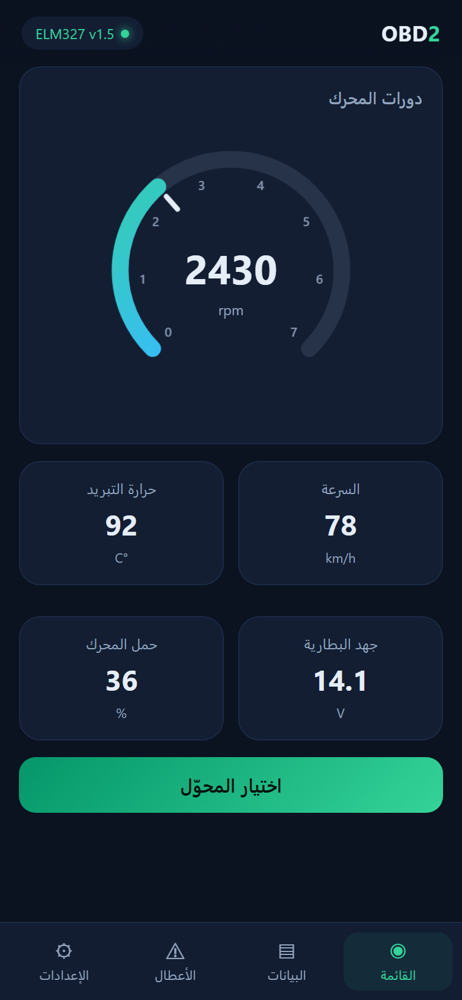
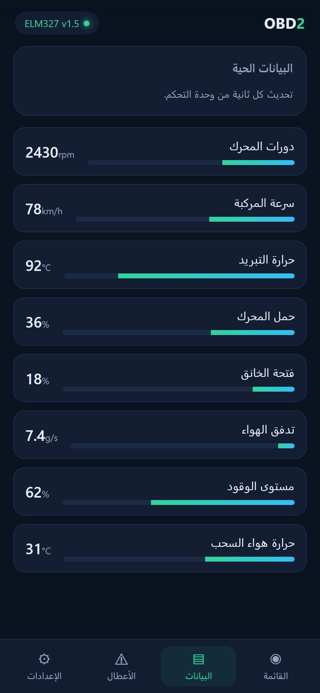
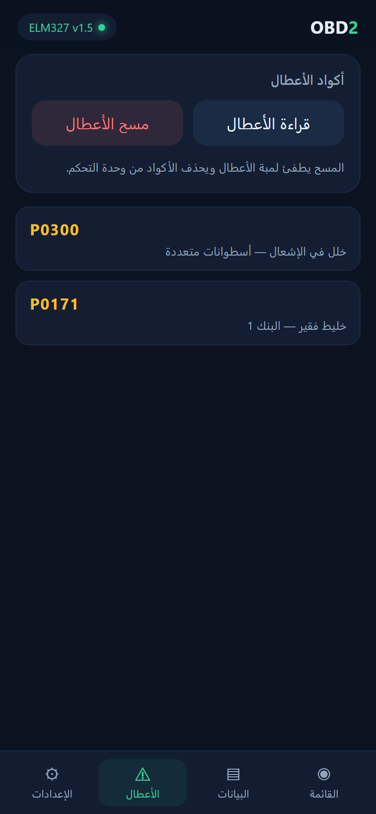
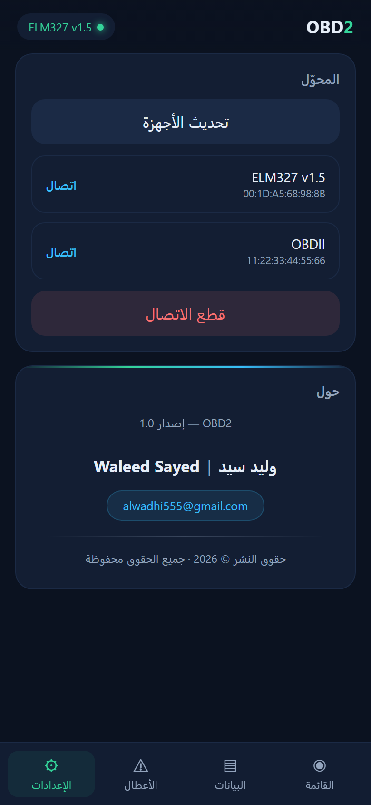

# OBD2 — تطبيق أندرويد لقراءة بيانات المركبة

تطبيق أندرويد مكتوب بلغة **Java** يتصل بجهاز **ELM327** عبر البلوتوث، ويعرض بيانات المحرك الحية
وأكواد الأعطال في واجهة عربية مبنية بـ `HTML` من ملفات محلية داخل التطبيق.

**English:** A native Android app written in **Java** that connects to an **ELM327** Bluetooth
adapter, streams live engine data, and reads or clears diagnostic trouble codes — inside a fast
Arabic RTL interface built with a local `HTML`.

## لقطات الشاشة | Screenshots

<div align="center" dir="ltr">
  
  
  
  
</div>

## المزايا

- **لوحة قيادة** مباشرة: دورات المحرك، السرعة، حرارة التبريد، جهد البطارية، وحمل المحرك.
- **بيانات حية** لثمانية حساسات مع أشرطة قياس وتحديث كل ثانية.
- **أكواد الأعطال**: قراءة أكواد `P/C/B/U` ومسحها، مع قاموس وصفي مختصر للأكواد الشائعة.
- **إدارة الاتصال**: عرض الأجهزة المقترنة، الاتصال والقطع، وعرض حالة الاتصال لحظيًا.
- واجهة عربية RTL بثيم داكن، تعمل بالكامل دون إنترنت.

## المتطلبات

- Android Studio حديثة (AGP 9.2.1، Gradle 9.4.1).
- JDK 17 أو أحدث.
- Android SDK 37 وأداة بناء 36+.
- جهاز ELM327 يدعم Bluetooth Classic (SPP) للتجربة على سيارة حقيقية.

## البناء


> مسار المشروع يحتوي حروفًا عربية، لذلك فُعّل `android.overridePathCheck=true` في
> `gradle.properties`. إن نقلت المشروع إلى مسار إنجليزي يمكنك حذف السطر.

## البنية

أهم الملفات في المشروع:

```
app/src/main/
├── AndroidManifest.xml
├── assets/obd/index.html          ← الواجهة كاملة (HTML/CSS/JS)
├── java/com/waleedsayed/obd2/
│   ├── MainActivity.java          ← WebView + الجسر مع الطبقة الأصلية
│   └── obd/
│       ├── ObdManager.java        ← اتصال البلوتوث وأوامر ELM327
│       ├── ObdBridge.java         ← الواجهة التي تستدعيها الصفحة
│       └── PidTable.java          ← فك ترميز PIDs و DTCs
└── res/                           ← التخطيطات والألوان والأيقونة
```

## الطبقة التقنية

### البلوتوث و ELM327

- الاتصال عبر **RFCOMM/SPP** (`00001101-0000-1000-8000-00805F9B34FB`) على خيط خلفي واحد،
  فلا تتجمد الواجهة أثناء القراءة.
- تسلسل التهيئة: `ATZ`, `ATE0`, `ATL0`, `ATS0`, `ATSP0` ثم أوامر `01xx` لقراءة الحساسات.
- القراءة تنتهي عند وصول محث `>` من المحوّل، مع مهلة لكل أمر.
- النتائج تُنشر كأحداث JSON: `state`, `pid`, `dtc`, `dtcCleared`, `raw`, `error`.

### فك الترميز

- معادلات SAE J1979 للـ PIDs المدعومة (RPM، السرعة، الحرارة، MAF، الخانق، الجهد…).
- أكواد الأعطال تُفكّ إلى صيغة `P0300` عبر بايتين لكل كود، وتُتجاهل الخانات الفارغة.

### واجهة HTML والجسر

الصفحة واحدة (`index.html`) بأربع شاشات: القائمة، البيانات، الأعطال، الإعدادات، وتنقّل سفلي
وموجّه بالـ hash. تُحمَّل من `file:///android_asset` ولا تتصل بأي نطاق خارجي.

الدوال المتاحة للصفحة عبر `window.NativeBridge`:

| الدالة | الوظيفة |
|---|---|
| `getStatus()` | حالة JSON: هل الاتصال قائم |
| `getDevices()` | الأجهزة المقترنة |
| `connect(address)` | الاتصال بجهاز |
| `disconnect()` | قطع الاتصال |
| `queryPid("0C")` | قراءة PID (الرد عبر حدث `pid`) |
| `readDtcs()` / `clearDtcs()` | قراءة الأعطال ومسحها |

والردود تعود من Java إلى JavaScript عبر:

```js
window.OBD.emit({ type: "pid", pid: "0C", value: 812, unit: "rpm" });
```

## ملاحظات تقنية

- محوّلات ELM327 الكلاسيكية عبر **Bluetooth Classic/SPP** فقط؛ محوّلات BLE تحتاج مسار GATT مستقلًا.
- `minSdk 26` و`targetSdk 36` و`compileSdk 37`.
- لا تُخزَّن قراءات المحرك على القرص، ولا يخرج أي شيء من الجهاز.
- الصفحة محلية بالكامل، والجسر مقيّد بها.

---

## حقوق النشر

© 2026 **وليد سيد | Waleed Sayed**. جميع الحقوق محفوظة.

للتواصل: [alwadhi555@gmail.com](mailto:alwadhi555@gmail.com)
